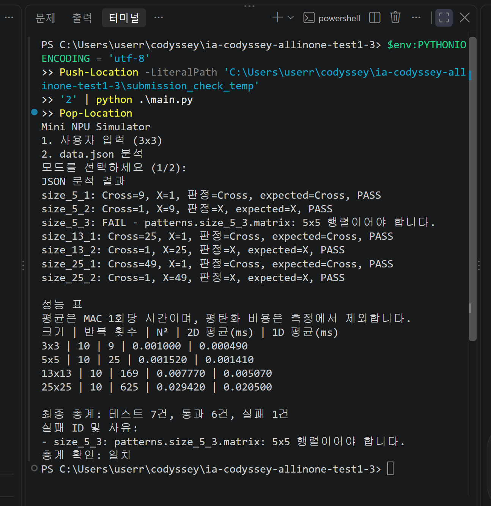

# Mini NPU Simulator 구현 및 검증

## 프로젝트 목적과 용어

그림을 숫자 표로 표현하고, 같은 칸의 숫자를 곱해 더하면 입력이 십자가(Cross)와 X 중 어디에 더 가까운지 점수로 설명할 수 있습니다. 이 미션은 신경망 연산 가속기(NPU)에서 쓰이는 기본 계산을 Python으로 실습합니다.

| 용어 | 쉬운 뜻 |
| --- | --- |
| 배열 | 여러 값을 순서대로 담은 목록입니다. 2D 배열은 행과 열이 있는 표이고, 1D 배열은 값을 한 줄로 펼친 목록입니다. 이 프로그램은 Python 리스트로 표현합니다. |
| 필터 | 비교 기준이 되는 모양입니다. 이 예시에서는 필터 A가 십자가, 필터 B가 X입니다. |
| MAC | Multiply–Accumulate. 같은 위치의 두 숫자를 곱하고, 그 결과를 지금까지의 합에 더합니다. |
| JSON | 이름과 값을 짝지어 저장하는 텍스트 형식입니다. 이 실습에서는 필터, 입력 배열, 기대 답을 한 파일에 모읍니다. |
| epsilon | 두 점수가 얼마나 가까우면 판정을 보류할지 정하는 허용오차입니다. 이 코드는 절댓값 차이가 `1e-9` 미만이면 `UNDECIDED`를 출력합니다. |

## 손으로 점수 5와 1 계산하기

| 행 | Cross 필터 A | X 필터 B | 입력이 Cross일 때 A의 곱 | 입력이 Cross일 때 B의 곱 |
| --- | --- | --- | --- | --- |
| 1행 | `0 1 0` | `1 0 1` | `0 1 0` → 1 | `0 0 0` → 0 |
| 2행 | `1 1 1` | `0 1 0` | `1 1 1` → 3 | `0 1 0` → 1 |
| 3행 | `0 1 0` | `1 0 1` | `0 1 0` → 1 | `0 0 0` → 0 |
| 합계 | | | **1 + 3 + 1 = 5** | **0 + 1 + 0 = 1** |

예를 들어 2행에서 Cross 입력 `1 1 1`과 X 필터 `0 1 0`을 비교하면 `1×0 + 1×1 + 1×0 = 1`입니다. Cross끼리는 1인 다섯 칸이 전부 겹쳐 A가 이기고, Cross와 X 사이에서는 가운데 한 칸만 겹칩니다. 입력을 X로 바꾸면 B는 `2 + 1 + 2 = 5`, A는 `0 + 1 + 0 = 1`이 됩니다.

## 기능별 실행과 검증

### 공통 실행 방법

1~4번 기능은 프로젝트 루트의 PowerShell에서 각각 아래 명령으로 시작합니다. 입력 예시의 한 줄은 Enter로 끝나는 입력 한 번에 해당합니다. 검증 환경은 교육장 PC의 Python 3.12.8입니다.

```powershell
python .\main.py
```

### 1. 직접 입력과 오류 복구

직접 입력 기능은 사용자가 만든 3×3 필터와 입력을 비교합니다. 한 행에 유한한 숫자 세 개가 들어와야 다음 행으로 넘어갑니다. 숫자 개수가 틀리거나 문자가 섞이면 오류 사유를 출력하고 같은 행을 다시 받습니다.

#### 실행 방법

처음 두 줄은 사용자 입력 모드와 직접 입력을 선택합니다. 이어지는 `0 1`과 `a 1 0`은 오류를 확인하기 위한 입력입니다. 세 번째 시도부터 필터 A, 필터 B, 입력 패턴에 각각 3행씩 들어갑니다.

```text
1
1
0 1
a 1 0
0 1 0
1 1 1
0 1 0
1 0 1
0 1 0
1 0 1
1 0 1
0 1 0
1 0 1
```

#### 실행 결과

캡처 위쪽에는 숫자 개수 오류와 문자 오류가 차례대로 표시됩니다. 두 오류 뒤 모두 `필터 A 1행`이 다시 나타나고, 유효한 첫 행이 입력된 뒤에 2행으로 넘어갑니다. 하단 `분석 결과`의 `A 점수: 1`, `B 점수: 5`, `판정: B`는 X 입력이 A와 한 칸, B와 다섯 칸에서 겹친 결과입니다.


### 2. 허용오차 판정

허용오차는 두 점수의 차이가 아주 작을 때 판정을 보류하는 기준입니다. `decide()`는 점수 차이의 절댓값이 `1e-9` 미만이면 `UNDECIDED`를 반환합니다.

#### 실행 방법

아래 예시에서 A는 모두 0이고 B는 첫 칸만 `0.0000000001`입니다. 입력 패턴도 첫 칸만 1이라 그 칸만 점수에 영향을 줍니다. 경계값 검증의 입력은 B 첫 행만 `0.000000001 0 0`으로 바꾼 별도 실행입니다.

```text
1
1
0 0 0
0 0 0
0 0 0
0.0000000001 0 0
0 0 0
0 0 0
1 0 0
0 0 0
0 0 0
```

#### 실행 결과

캡처 중간의 `필터 B 1행`에 `0.0000000001 0 0`이 있고, 하단 `분석 결과`에는 `A 점수: 0`, `B 점수: 1e-10`, `판정: 판정 불가 (UNDECIDED)`가 표시됩니다. 차이가 허용오차의 10분의 1이어서 판정이 보류됐습니다. 경계값을 입력한 별도 실행에서는 차이가 `1e-9`로 허용오차와 같아서 `판정: B`가 나왔습니다.


### 3. 자동 생성

자동 생성 기능은 3×3 숫자 표를 입력하는 과정을 줄입니다. 프로그램이 가운데 행과 열로 필터 A(Cross)를, 두 대각선으로 필터 B(X)를 만들고, 메뉴에서 고른 모양으로 입력 패턴을 생성합니다.

#### 실행 방법

아래 입력 순서는 사용자 입력 모드, 자동 생성, Cross입니다. X 예시는 마지막 입력만 `2`입니다.

```text
1
2
1
```

#### 실행 결과

캡처 아래쪽의 자동 생성 실행에는 `필터 A=Cross, 필터 B=X` 생성 안내와 `A 점수: 5`, `B 점수: 1`, `판정: A`가 표시됩니다. 손으로 계산한 값과 일치합니다. 화면 위쪽의 `UNDECIDED`는 앞선 허용오차 검증 결과입니다. X를 선택한 별도 실행에서는 A=1, B=5로 B가 나왔습니다.


### 4. 정상 샘플 JSON 분석

JSON 분석 기능은 여러 크기의 입력을 한 번에 채점합니다. 프로그램은 `data.json`에서 패턴과 같은 크기의 두 필터를 찾아 MAC 점수를 계산하고, 판정이 `expected`와 일치하면 PASS로 기록합니다.

#### 실행 방법

공통 실행 명령으로 프로그램을 시작한 후 첫 메뉴에서 JSON 분석을 선택하는 입력은 아래 한 줄입니다.

```text
2
```

#### 실행 결과

터미널의 `JSON 분석 결과`에는 케이스별 Cross·X 점수, 판정, `expected`, `PASS`가 표시됩니다. 5×5, 13×13, 25×25에 각각 Cross와 X 입력이 하나씩 있습니다. 같은 모양의 점수는 크기별로 9, 25, 49이고 다른 모양의 점수는 가운데 한 칸의 1입니다. 하단에는 `최종 총계: 테스트 6건, 통과 6건, 실패 0건`, `실패 ID 및 사유: 없음`, `총계 확인: 일치`가 표시됐습니다.

### 5. 오류를 넣은 JSON 분석

오류 주입 검증은 개별 입력이 실패해도 이후 케이스를 계속 처리하고 실패 사유를 집계하는지 확인합니다. `size_5_3`에는 5×5가 필요한 자리에 4×4 배열이 들어갑니다. `size_13_3`에는 모든 칸이 0인 13×13 배열과 기대 답 Cross가 들어갑니다.

#### 실행 방법

아래 PowerShell 블록은 프로젝트 루트에서 실행합니다. 임시 폴더에 프로그램과 두 오류 사례가 추가된 JSON을 만들고, 복사한 `main.py`에 메뉴 입력 `2`를 전달합니다. 실행이 끝나면 임시 폴더가 정리됩니다.

```powershell
@'
import json
from pathlib import Path
import shutil
import subprocess
import sys
import tempfile

document = json.loads(Path("data.json").read_text(encoding="utf-8"))
patterns = {}
for case_id, case in document["patterns"].items():
    patterns[case_id] = case
    if case_id == "size_5_2":
        patterns["size_5_3"] = {
            "input": [[0, 1, 1, 0], [1, 1, 1, 1], [1, 1, 1, 1], [0, 1, 1, 0]],
            "expected": "+",
        }
    if case_id == "size_13_2":
        patterns["size_13_3"] = {
            "input": [[0] * 13 for _ in range(13)],
            "expected": "+",
        }
document["patterns"] = patterns

with tempfile.TemporaryDirectory() as directory:
    folder = Path(directory)
    shutil.copyfile("main.py", folder / "main.py")
    (folder / "data.json").write_text(json.dumps(document), encoding="utf-8")
    subprocess.run([sys.executable, str(folder / "main.py")], input="2\n",
                   text=True, check=True)
'@ | python -
```

#### 실행 결과

캡처 위쪽 `JSON 분석 결과`의 `size_5_3` 행에는 5×5가 필요하다는 메시지가 표시됩니다. `size_13_3` 행에는 `Cross=0`, `X=0`, `UNDECIDED`가 표시되며 기대 답 Cross와 일치하지 않아 FAIL로 기록됩니다. 두 오류 뒤에 각각 `size_13_1`과 `size_25_1`의 PASS가 이어집니다. 가운데 성능 표에는 네 크기의 MAC 측정값이 있고, 맨 아래에는 **8건 중 6 PASS·2 FAIL**, 두 실패 ID 및 사유, `총계 확인: 일치`가 표시됩니다.

아래 기존 캡처는 당시 별도 오류 포함 데이터의 실행 화면입니다. 위 명령은 저장소의 자체 샘플에 같은 종류의 오류를 추가해 화면의 결과를 재현합니다.



## 구현 과정과 검증 범위

1. 3×3 필터와 입력의 같은 위치를 곱해 누적하고, 두 점수로 판정하도록 구현했습니다. 행별 입력 검사와 epsilon 판정을 추가했습니다.
2. JSON 모드를 추가해 크기에 맞는 필터를 고르고, 판정과 `expected`를 비교해 케이스별 결과와 총계를 표시했습니다. Git 기록 `3446078`에서 과제 스키마에 맞게 패턴 배열 필드를 `matrix`에서 `input` 우선으로 수정했습니다. `input`이 없는 예전 자료는 `matrix` 등의 별칭도 읽습니다. `filters.size_5.cross`처럼 필터를 저장하고, `patterns.size_5_1.input`에 입력을 둡니다. `expected`의 `+`와 `x`는 각각 Cross와 X로 읽습니다.
3. 저장소에서 바로 실행할 수 있게 0과 1로 만든 자체 샘플을 추가했습니다(Git 기록 `310c337`). 5·13·25 크기에서 중앙 행과 열은 Cross, 두 대각선은 X로 구성했습니다. 현재 루트의 [data.json](../data.json)은 이 자체 제작 샘플입니다. 제출 당시 오류 포함 실행 기록은 5번 검증의 기존 캡처에 남아 있습니다.
4. 교육장 PC의 Python 3.12.8에서 직접 입력 복구, epsilon 미만과 경계, 자동 생성 Cross와 X, 자체 JSON 6건, 임시 오류 포함 JSON 8건을 실행했습니다. 교육 제공 원본 파일은 현재 작업 환경에서 확보하지 못했습니다.

### 구현 보조와 직접 검증

Codex는 Python 구현과 검증 방법 정리를 보조했습니다. 프로젝트 작성자는 터미널에 입력값을 직접 입력해 점수, 오류 메시지, 판정을 확인하고, 이 문서의 기존 스크린샷을 캡처했습니다. 가이드 작성 시 Codex가 교육장 PC에서 문서의 명령과 입력값을 다시 실행해 결과를 확인했습니다.

## N²와 성능 비교

`N²`는 한 번의 MAC에서 방문하는 칸 수입니다. 예를 들어 5×5는 25칸입니다. 3·5·13·25의 경우 각각 9·25·169·625칸입니다. `O(N²)`는 N이 커질 때 작업량이 늘어나는 방식을 나타냅니다. 한 변을 두 배로 늘리면 칸 수는 네 배가 됩니다. 칸마다 곱하고 합에 더하는 일을 한 번씩 하므로 2D와 1D 모두 `O(N²)`입니다.

| 보너스 | 구현 근거 |
| --- | --- |
| Cross/X 자동 생성 | `generate_pattern(N, label)`은 양의 정수 N을 받습니다. 홀수 Cross는 가운데 행과 열, 짝수 Cross는 가운데 두 행과 두 열을 채웁니다. X는 두 대각선을 채웁니다. 메뉴에서 3×3 예시를 만들고, JSON 성능 표의 입력 생성에도 같은 함수를 씁니다. |
| 2D·1D MAC 비교 | `mac()`은 행·열을 돌고, `flatten_matrix()`는 두 배열을 같은 행 순서로 펼치며, `mac_1d()`는 길이 N²를 한 번 순회합니다. `_measure_mac_pair()`가 두 점수의 일치를 먼저 확인하고 같은 입력으로 각 구현을 10회 측정합니다. |

표의 시간은 `time.perf_counter()`로 잰 MAC 함수 호출 1회당 평균 밀리초입니다. 생성·검증·평탄화·점수 일치 확인·화면 출력은 측정 구간 밖에 있습니다. 모드 1은 필터 A와 입력 패턴을 측정합니다. 모드 2의 표는 크기별로 별도 생성한 Cross 필터와 X 입력을 측정합니다. 시간은 PC와 실행 시점에 따라 달라집니다.

## 요구사항 대응표

| 요구사항 | 검증 항목 | 확인할 파일과 기능 |
| --- | --- | --- |
| 3×3 직접 입력, MAC 점수, 잘못된 행 복구 | 1 | [main.py](../main.py)의 `read_matrix()`, `mac()` |
| 작은 점수 차이와 경계 판정 | 2 | [main.py](../main.py)의 `decide()` |
| 보너스 자동 생성 | 3 | [main.py](../main.py)의 `generate_pattern()` |
| JSON 형식, 정상 케이스 채점 | 4 | [data.json](../data.json), [main.py](../main.py)의 `_extract_pattern()`, `run_json_analysis()` |
| 개별 오류 처리와 합계 | 5 | [main.py](../main.py)의 `run_json_analysis()` |
| 보너스 2D·1D 비교 및 N² | 3~5 | [main.py](../main.py)의 `mac_1d()`, `_measure_mac_pair()`, `_benchmark_sizes()` |

## 주요 설계 원리

### 같은 위치의 값과 점수

십자가와 X의 가운데 칸은 둘 다 1입니다. 서로 다른 모양을 비교해도 그 칸의 `1×1`이 점수에 더해집니다. 같은 모양과 비교할 때는 1이 있는 칸이 모두 겹쳐 더 높은 점수를 얻습니다.

### 판정의 경계

비교 조건은 `abs(score_a - score_b) < 1e-9`입니다. 점수 차이가 0인 경우를 포함해 기준 미만이면 판정을 보류합니다. 기준 이상이면 높은 점수 쪽으로 판정합니다.

### 배열 형태와 계산 결과

두 2D 배열을 모두 같은 행 순서로 펼치면 곱셈에 쓰이는 원소의 짝과 누적 순서가 유지됩니다. 따라서 2D와 1D 점수를 직접 비교할 수 있습니다. 측정 시간은 실행 환경에 따라 달라지며 두 방식은 모두 N²개의 칸을 처리합니다.

### 케이스 단위 오류 기록과 검증 범위

실패 ID와 사유를 건별로 남겨 크기 오류와 동점 판정을 구분할 수 있습니다. 오류 주입 실행에서 정상 여섯 건이 계속 처리됐습니다. 자체 샘플의 검증 범위는 5·13·25 크기의 Cross와 X 입력이며, 다른 모양에 대한 분류 성능은 이 결과로 판단하기 어렵습니다.
