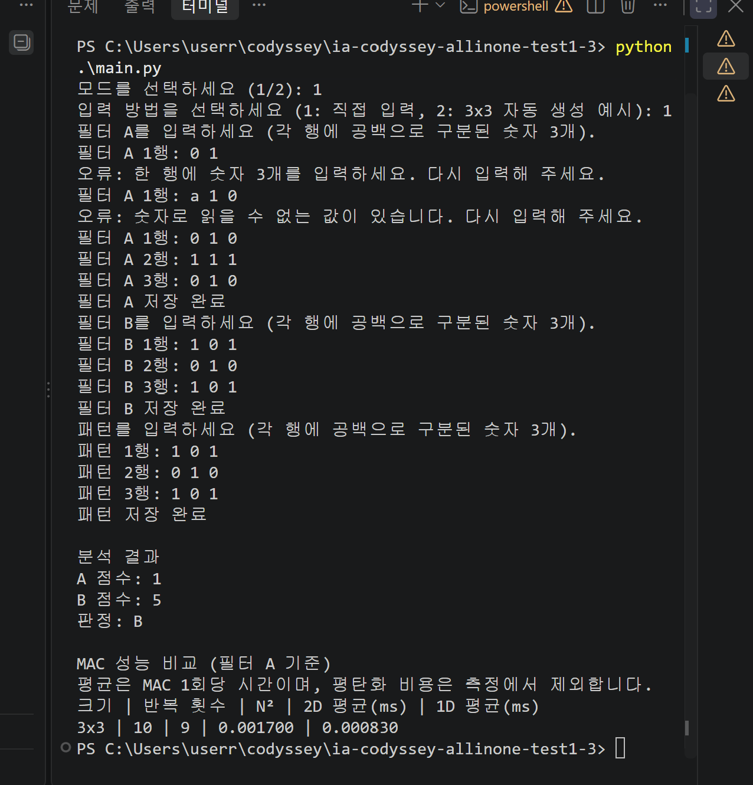
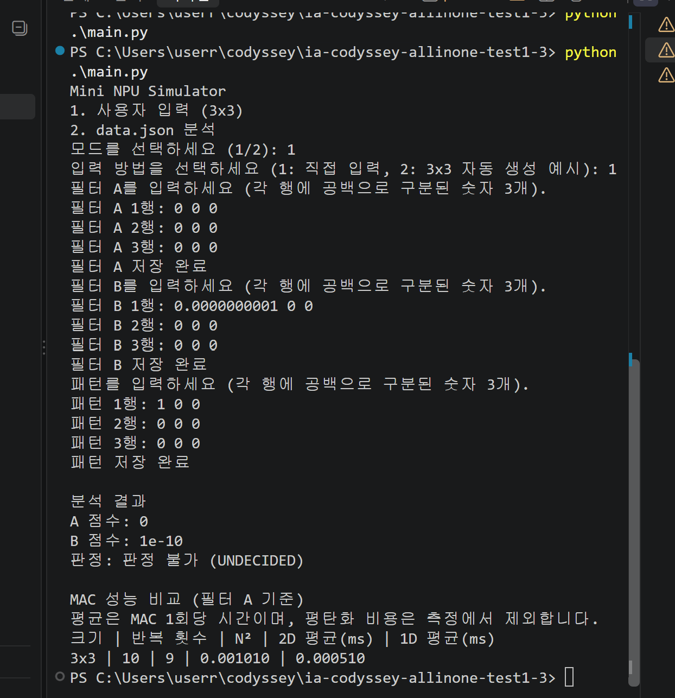
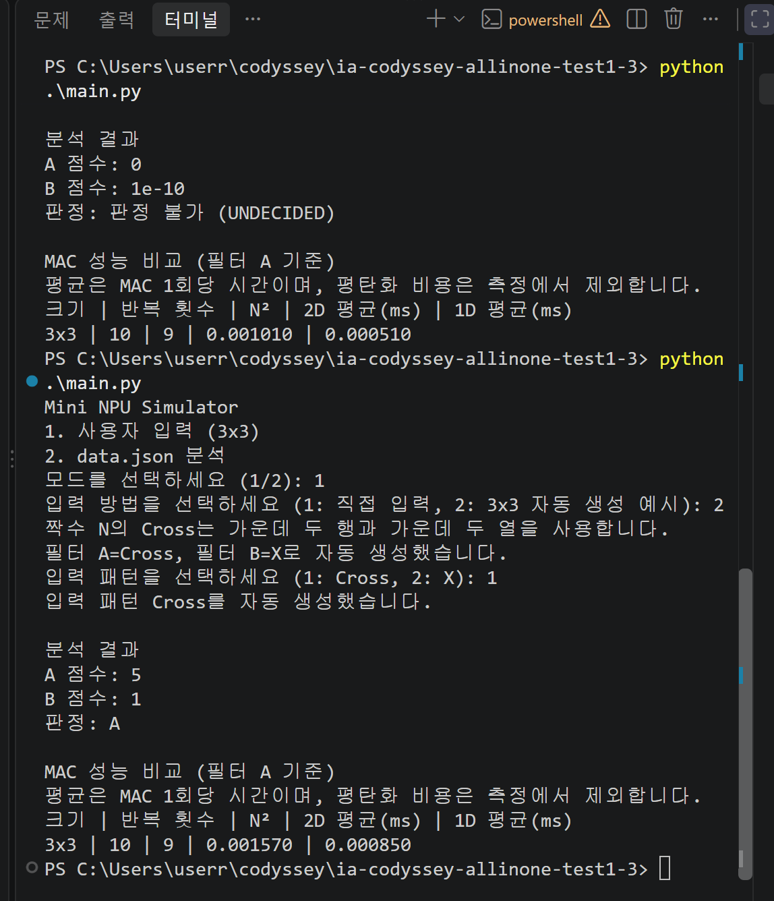

# Mini NPU Simulator 실습·발표 가이드

## 무엇을 만드는 미션인가요?

그림을 숫자 표로 표현하고, 같은 칸의 숫자를 곱해 더하면 입력이 십자가(Cross)와 X 중 어디에 더 가까운지 점수로 설명할 수 있습니다. 이 미션은 신경망 연산 가속기(NPU)에서 쓰이는 기본 계산을 Python으로 실습합니다.

| 용어 | 쉬운 뜻 |
| --- | --- |
| 배열 | 여러 값을 순서대로 담은 목록입니다. 2D 배열은 행과 열이 있는 표이고, 1D 배열은 값을 한 줄로 펼친 목록입니다. 이 프로그램은 Python 리스트로 표현합니다. |
| 필터 | 비교 기준이 되는 모양입니다. 이 예시에서는 필터 A가 십자가, 필터 B가 X입니다. |
| MAC | Multiply–Accumulate. 같은 위치의 두 숫자를 곱하고, 그 결과를 지금까지의 합에 더합니다. |
| JSON | 이름과 값을 짝지어 저장하는 텍스트 형식입니다. 이 실습에서는 필터, 입력 배열, 기대 답을 한 파일에 모읍니다. |
| epsilon | 두 점수가 얼마나 가까우면 판정을 보류할지 정하는 허용오차입니다. 이 코드는 절댓값 차이가 `1e-9` 미만이면 `UNDECIDED`를 출력합니다. |

## 손으로 점수 5와 1 계산하기

| 행 | Cross 필터 A | X 필터 B | 입력이 Cross일 때 A의 곱 | 입력이 Cross일 때 B의 곱 |
| --- | --- | --- | --- | --- |
| 1행 | `0 1 0` | `1 0 1` | `0 1 0` → 1 | `0 0 0` → 0 |
| 2행 | `1 1 1` | `0 1 0` | `1 1 1` → 3 | `0 1 0` → 1 |
| 3행 | `0 1 0` | `1 0 1` | `0 1 0` → 1 | `0 0 0` → 0 |
| 합계 | | | **1 + 3 + 1 = 5** | **0 + 1 + 0 = 1** |

예를 들어 2행에서 Cross 입력 `1 1 1`과 X 필터 `0 1 0`을 비교하면 `1×0 + 1×1 + 1×0 = 1`입니다. Cross끼리는 1인 다섯 칸이 전부 겹쳐 A가 이기고, Cross와 X 사이에서는 가운데 한 칸만 겹칩니다. 입력을 X로 바꾸면 B는 `2 + 1 + 2 = 5`, A는 `0 + 1 + 0 = 1`이 됩니다.

## 시연 순서와 읽을 대본

PowerShell을 프로젝트 루트에서 열고, **시연 1~4 각각을 시작할 때** 아래 명령을 실행합니다. 입력 블록의 위에서부터 한 줄씩 입력하고 Enter를 누릅니다. 명령에 성공한 교육장 PC의 Python 버전은 3.12.8입니다.

```powershell
python .\main.py
```

### 1. 직접 입력과 오류 복구

처음 두 줄은 사용자 입력 모드와 직접 입력을 선택합니다. 다음 두 줄은 필터 A 첫 행에 일부러 넣는 오류이고, 그다음부터 A·B·입력 패턴을 각각 3행씩 입력합니다.

```text
1
1
0 1
a 1 0
0 1 0
1 1 1
0 1 0
1 0 1
0 1 0
1 0 1
1 0 1
0 1 0
1 0 1
```

**보여줄 곳**은 위쪽의 숫자 개수 오류와 문자 오류, 세 번 반복되는 `필터 A 1행` 프롬프트, 아래쪽의 `A 점수: 1`, `B 점수: 5`, `판정: B`입니다.

> “먼저 숫자를 두 개만 입력하고, 다시 문자도 넣어 보겠습니다. 두 번 모두 첫 번째 행에서 다시 입력할 수 있습니다. 값을 고친 뒤 X를 입력하니 가운데만 겹치는 A는 1점, 다섯 칸이 겹치는 B는 5점이 나옵니다.”



### 2. 허용오차 판정

다시 실행한 뒤 A는 전부 0으로, B는 첫 칸만 `0.0000000001`로 둡니다. 입력 패턴은 첫 칸만 1이라 그 칸만 점수에 영향을 줍니다.

```text
1
1
0 0 0
0 0 0
0 0 0
0.0000000001 0 0
0 0 0
0 0 0
1 0 0
0 0 0
0 0 0
```

**보여줄 곳**은 B의 첫 행과 하단의 `A 점수: 0`, `B 점수: 1e-10`, `판정: 판정 불가 (UNDECIDED)`입니다. 경계도 보여주려면 다시 실행하고 B 첫 행만 `0.000000001 0 0`으로 바꿉니다. 차이가 정확히 `1e-9`여서 `판정: B`가 나옵니다.

> “B의 점수가 조금 더 높지만, 차이는 기준값의 10분의 1입니다. 그래서 판정을 보류합니다. 차이가 기준값과 같으면 더 높은 쪽을 선택합니다.”



### 3. 자동 생성

다시 실행하고 사용자 입력 모드, 자동 생성, Cross 입력 순으로 고릅니다.

```text
1
2
1
```

**보여줄 곳**은 캡처 아래쪽 실행의 `필터 A=Cross, 필터 B=X` 안내와 `A 점수: 5`, `B 점수: 1`, `판정: A`입니다. 위쪽에 보이는 `UNDECIDED`는 직전 시연의 결과입니다. 같은 메뉴에서 마지막 선택을 `2`로 바꾸면 X가 생성되어 A=1, B=5로 B가 나옵니다.

> “이번에는 표를 직접 입력하지 않고 메뉴에서 십자가를 고릅니다. 프로그램이 두 필터와 입력을 만들어 주고, 손으로 계산한 것과 같은 5점과 1점이 나옵니다.”



### 4. 정상 샘플 JSON 분석

다시 실행하고 첫 메뉴에서 아래 한 줄만 입력합니다.

```text
2
```

**보여줄 곳**은 케이스마다 표시되는 두 점수, 판정, `expected`와 `PASS`입니다. 5×5, 13×13, 25×25마다 정답이 Cross인 입력 한 개와 X인 입력 한 개가 있습니다. 같은 모양의 점수는 크기별로 9, 25, 49이고 다른 모양과의 점수는 가운데 한 칸의 1입니다. 하단에 `최종 총계: 테스트 6건, 통과 6건, 실패 0건`, `실패 ID 및 사유: 없음`, `총계 확인: 일치`가 나옵니다.

> “JSON을 한 번 읽어서 여섯 입력을 차례대로 분석합니다. 계산한 판정이 파일의 기대 답과 같아 여섯 건 모두 통과했습니다.”

### 5. 오류를 넣은 JSON 분석

프로젝트 루트의 PowerShell에서 아래 블록을 실행합니다. Python이 임시 폴더에 프로그램과 변형한 JSON을 만들고, 그곳의 `main.py`를 실행해 메뉴 입력 `2`를 전달합니다. 실행이 끝나면 임시 폴더가 정리됩니다.

```powershell
@'
import json
from pathlib import Path
import shutil
import subprocess
import sys
import tempfile

document = json.loads(Path("data.json").read_text(encoding="utf-8"))
patterns = {}
for case_id, case in document["patterns"].items():
    patterns[case_id] = case
    if case_id == "size_5_2":
        patterns["size_5_3"] = {
            "input": [[0, 1, 1, 0], [1, 1, 1, 1], [1, 1, 1, 1], [0, 1, 1, 0]],
            "expected": "+",
        }
    if case_id == "size_13_2":
        patterns["size_13_3"] = {
            "input": [[0] * 13 for _ in range(13)],
            "expected": "+",
        }
document["patterns"] = patterns

with tempfile.TemporaryDirectory() as directory:
    folder = Path(directory)
    shutil.copyfile("main.py", folder / "main.py")
    (folder / "data.json").write_text(json.dumps(document), encoding="utf-8")
    subprocess.run([sys.executable, str(folder / "main.py")], input="2\n",
                   text=True, check=True)
'@ | python -
```

**보여줄 곳**은 `size_5_3`의 크기 오류, `size_13_3`의 0 대 0 동점, 각 오류 뒤에도 이어지는 PASS, 가운데 성능 표, 맨 아래 **8건 중 6 PASS·2 FAIL**과 두 실패 ID입니다. `size_5_3`은 5×5가 필요한 자리에 4×4를 넣어 채점 전에 거절됩니다. `size_13_3`은 13×13 크기는 맞지만 전부 0이라 판정을 보류하고, 기대 답인 Cross와 비교해 실패로 기록합니다.

> “일부러 실패할 두 입력을 추가했습니다. 한 건은 표 크기가 틀렸고, 다른 한 건은 두 점수가 모두 0입니다. 프로그램은 이유를 남기고 다음 입력도 처리합니다. 여섯 건 통과에 두 건 실패를 더하면 전체 여덟 건입니다.”

아래 기존 캡처는 당시 별도 오류 포함 데이터의 실행 화면입니다. 위 명령은 저장소의 자체 샘플에 같은 종류의 오류를 추가해 화면의 결과를 재현합니다.


## 구현 과정과 검증 범위

1. 3×3 필터와 입력의 같은 위치를 곱해 누적하고, 두 점수로 판정하도록 구현했습니다. 행별 입력 검사와 epsilon 판정을 추가했습니다.
2. JSON 모드를 추가해 크기에 맞는 필터를 고르고, 판정과 `expected`를 비교해 케이스별 결과와 총계를 표시했습니다. Git 기록 `3446078`에서 과제 스키마에 맞게 패턴 배열 필드를 `matrix`에서 `input` 우선으로 수정했습니다. `input`이 없는 예전 자료는 `matrix` 등의 별칭도 읽습니다. `filters.size_5.cross`처럼 필터를 저장하고, `patterns.size_5_1.input`에 입력을 둡니다. `expected`의 `+`와 `x`는 각각 Cross와 X로 읽습니다.
3. 저장소에서 바로 실행할 수 있게 0과 1로 만든 자체 샘플을 추가했습니다(Git 기록 `310c337`). 5·13·25 크기에서 중앙 행과 열은 Cross, 두 대각선은 X로 구성했습니다. 현재 루트의 [data.json](../data.json)은 이 자체 제작 샘플입니다. 제출 당시 오류 포함 실행 기록은 시연 5의 기존 캡처에 남아 있습니다.
4. 이 가이드를 작성하면서 교육장 PC의 Python 3.12.8에서 직접 입력 복구, epsilon 미만과 경계, 자동 생성 Cross와 X, 자체 JSON 6건, 임시 오류 포함 JSON 8건을 실행했습니다. 현재 교육 제공 원본 파일로 별도 재실행한 기록과 Python 3.8 실행 기록은 이 가이드의 검증 범위에 포함되지 않습니다.

**역할 설명 대본**

> “Codex의 도움을 받아 Python 구현과 검증 방법을 정리했습니다. 저는 터미널에 시연 값을 직접 입력하고 점수, 오류 메시지, 판정을 확인한 뒤 기존 증빙 화면을 캡처했습니다. 이번 가이드를 작성할 때 Codex가 교육장 PC에서 문서의 입력과 명령을 다시 실행해 확인했습니다.”

## N²와 성능 비교

`N²`는 한 번의 MAC에서 방문하는 칸 수입니다. 예를 들어 5×5는 25칸입니다. 3·5·13·25의 경우 각각 9·25·169·625칸입니다. `O(N²)`는 N이 커질 때 작업량이 늘어나는 방식을 나타냅니다. 한 변을 두 배로 늘리면 칸 수는 네 배가 됩니다. 칸마다 곱하고 합에 더하는 일을 한 번씩 하므로 2D와 1D 모두 `O(N²)`입니다.

| 보너스 | 구현 근거 |
| --- | --- |
| Cross/X 자동 생성 | `generate_pattern(N, label)`은 양의 정수 N을 받습니다. 홀수 Cross는 가운데 행과 열, 짝수 Cross는 가운데 두 행과 두 열을 채웁니다. X는 두 대각선을 채웁니다. 메뉴에서 3×3 예시를 만들고, JSON 성능 표의 입력 생성에도 같은 함수를 씁니다. |
| 2D·1D MAC 비교 | `mac()`은 행·열을 돌고, `flatten_matrix()`는 두 배열을 같은 행 순서로 펼치며, `mac_1d()`는 길이 N²를 한 번 순회합니다. `_measure_mac_pair()`가 두 점수의 일치를 먼저 확인하고 같은 입력으로 각 구현을 10회 측정합니다. |

표의 시간은 `time.perf_counter()`로 잰 MAC 함수 호출 1회당 평균 밀리초입니다. 생성·검증·평탄화·점수 일치 확인·화면 출력은 측정 구간 밖에 있습니다. 모드 1은 필터 A와 입력 패턴을 측정합니다. 모드 2의 표는 크기별로 별도 생성한 Cross 필터와 X 입력을 측정합니다. 시간은 PC와 실행 시점에 따라 달라집니다.

## 요구사항을 어디에서 보여주나요?

| 요구사항 | 시연 | 확인할 파일과 기능 |
| --- | --- | --- |
| 3×3 직접 입력, MAC 점수, 잘못된 행 복구 | 1 | [main.py](../main.py)의 `read_matrix()`, `mac()` |
| 작은 점수 차이와 경계 판정 | 2 | [main.py](../main.py)의 `decide()` |
| 보너스 자동 생성 | 3 | [main.py](../main.py)의 `generate_pattern()` |
| JSON 형식, 정상 케이스 채점 | 4 | [data.json](../data.json), [main.py](../main.py)의 `_extract_pattern()`, `run_json_analysis()` |
| 개별 오류 처리와 합계 | 5 | [main.py](../main.py)의 `run_json_analysis()` |
| 보너스 2D·1D 비교 및 N² | 3~5 | [main.py](../main.py)의 `mac_1d()`, `_measure_mac_pair()`, `_benchmark_sizes()` |

## 예상 질문과 답변

- **왜 X 필터도 1점을 받나요?** 십자가와 X 모두 가운데 칸은 1입니다. 그 칸에서 `1×1`이 한 번 나옵니다.
- **왜 점수 차이가 정확히 `1e-9`면 판정하나요?** 코드가 ‘작거나 같다’ 대신 ‘작다’를 사용합니다. 경계에서는 더 높은 점수가 이깁니다.
- **2D를 1D로 펼치면 왜 점수가 같나요?** 두 표를 같은 순서로 펼치니까 곱하는 칸의 짝과 더하는 순서가 같습니다.
- **1D가 항상 더 빠른가요?** 표는 이 PC에서 MAC 호출을 측정한 값입니다. 두 방식 모두 같은 수의 칸을 처리하며 실제 시간은 실행 환경에 따라 달라집니다.
- **오류 포함 2 FAIL은 무엇을 보여주나요?** 의도대로 두 사례의 실패 이유가 표시되고, 정상 입력 여섯 건은 계속 처리됐다는 뜻입니다.
- **샘플 여섯 건으로 무엇을 확인했나요?** 직접 만든 세 크기의 Cross/X 정답을 맞히는지 확인했습니다. 다른 그림과 크기의 모든 입력을 검증한 결과까지 의미하지는 않습니다.
